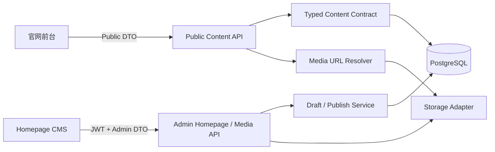

# 前端替换与 API 接入声明

本文指导新的前端团队在不破坏现有内容、媒体和发布流程的前提下，替换「观止东方 Guanzhi Oriental」官网展示层或 Homepage CMS 管理端。

## 1. 总体边界

当前系统已经分离页面展示、内容数据和媒体存储。前端可以重新设计，通常不需要修改 PostgreSQL、Content Contract 或后台发布机制。

需要区分两个可独立替换的前端：

1. **官网前台**：面向访客，读取 Public Content / Settings API。
2. **Homepage CMS**：面向 ADMIN / EDITOR，读取和写入 Admin Homepage / Media API。

可以只替换官网视觉而保留 CMS，也可以只重做 CMS 界面。浏览器不能直接访问数据库，React 不能推导媒体 `storageKey`，`page_translations` 继续作为已发布投影，Homepage 草稿继续保存在 `page_revisions`。



## 2. 是否需要调整后端

| 目标 | 后端是否调整 | 说明 |
| --- | --- | --- |
| 重做视觉、排版、动效、组件 | 否 | DTO 不变即可 |
| 调整现有字段的展示位置 | 否 | 仍消费相同字段 |
| 重做响应式、无障碍、错误状态 | 否 | 属于前端能力 |
| 新增首页字段 | 是 | Contract、DTO、Seed、表单和测试必须同步 |
| 新增第八种首页区块 | 是 | 当前严格限定七种 typed blocks |
| 自由拖拽 Page Builder | 是，且属于新阶段 | 当前不是通用 Page Builder |
| News / Projects / Cases | 是，且属于新模块 | 当前不在 Homepage CMS 范围 |
| Next.js / SSR | 通常需要部署调整 | API 可复用，但需缓存和服务端请求设计 |
| 前后端不同域名 | 需要配置 | CORS、API Base URL 和鉴权拓扑需确认 |
| JWT 改为 HttpOnly Cookie | 是 | 登录、CSRF、跨域策略需配套修改 |
| 图片裁剪、视频转码、CDN | 是 | 属于 Media Pipeline 后续能力 |

接口变化应先修改 `backend/src/content/contract.ts`，再同步 Public DTO、Admin DTO、前端 runtime guard、Seed 和测试，不能只修改其中一层。

## 3. 官网前台接入

### 3.1 必需接口

- `GET /api/v1/content/settings`
- `GET /api/v1/content/pages/home?locale=zh-CN`
- `GET /api/v1/content/pages/home?locale=en`
- `POST /api/v1/inquiries`

本地 Vite 将相对路径 `/api` 代理到 `http://127.0.0.1:8080`。同域生产部署建议继续使用相对路径，避免在构建产物中写死服务器地址。

若新前端独立部署，可使用 `VITE_API_BASE_URL` 等公开变量，但后端 `CORS_ORIGINS` 必须精确包含前端域名。数据库密码、JWT secret、存储凭据绝不能出现在前端环境变量。

### 3.2 首页文档

Public Homepage DTO 包含 `version`、`id`、`slug`、`locale`、`publishedAt`、`title`、`seo` 和 `blocks`。当前固定七种 block：

1. `hero`
2. `about`
3. `capabilities`
4. `motifs`
5. `jiangnan`
6. `partners`
7. `contact`

`hero` 必须启用。其他区块可能被 CMS 关闭，Public DTO 会过滤关闭的 block 和 item。新渲染器必须接受“Hero + 任意可见子集”，不能因为公开响应少于七块而白屏。

### 3.3 语言与失败降级

- 每次切换语言请求一份完整 Homepage Document。
- 先通过 runtime guard，再原子替换当前页面。
- 请求失败或 DTO 非法时保留当前内容或静态 fallback。
- 同步更新 `html.lang`、title 和 meta description。
- 不要逐区块请求，避免中英文混合和页面半更新。

### 3.4 Settings 与 Footer

品牌、法定主体、旗舰名称和邮箱来自：

- `brand.name`
- `company.legalName`
- `flagship.name`
- `contact.email`
- `site.locales`

Footer 必须独立于 Contact block，并由 Public Settings 生成。不要从 Contact 内容重新引入主体、邮箱、年份或所在地。所在地尚未确认，不得硬编码“杭州”或“北京”。

### 3.5 媒体

官网只消费服务端解析后的 `url`、`alt`、`mimeType`、`width`、`height` 和视频 `poster`。不得暴露服务器绝对路径、上传根目录、`storageKey` 或存储密钥。

当引用含 `assetId` 时，服务端媒体元数据是公开展示权威；新前端不得猜测 URL 规则绕过 resolver。

### 3.6 CTA

- 将 scroll target 映射到真实存在的区块锚点。
- 区块关闭后重新计算下一可见锚点。
- 没有下一目标时隐藏滚动提示。
- 只接受 Contract 允许的 URL 协议。
- Inquiry CTA 继续调用 Inquiry API，不在浏览器保存客户隐私数据。

## 4. Homepage CMS 接入

### 4.1 登录与会话

- `POST /api/v1/admin/auth/login`
- `GET /api/v1/admin/auth/me`

当前管理端将 JWT 放入 `sessionStorage`，并使用 `Authorization: Bearer <token>`：

- 恢复页面时必须调用 `/admin/auth/me`，不能信任缓存用户资料。
- 收到 401 后清会话并回登录页。
- 客户端角色判断只决定界面，服务端权限才是最终边界。
- token 不得写入日志、URL、错误上报正文或 Git。

### 4.2 Homepage 专用接口

- `GET /api/v1/admin/homepage`
- `PUT /api/v1/admin/homepage/draft`
- `POST /api/v1/admin/homepage/publish`

草稿请求结构：

```json
{
  "baseRevision": 0,
  "translations": [
    { "locale": "zh-CN", "title": "...", "seoTitle": null, "seoDescription": null, "blocks": { "version": 1, "blocks": [] } },
    { "locale": "en", "title": "...", "seoTitle": null, "seoDescription": null, "blocks": { "version": 1, "blocks": [] } }
  ]
}
```

以上 `blocks` 只表示结构位置；真实提交必须包含两种语言各自完整、合法的七种首页 blocks。

发布请求：

```json
{ "revision": 1 }
```

### 4.3 草稿和发布语义

- 中英文必须作为一个原子草稿保存。
- 保存使用 `baseRevision` 乐观锁。
- 409 表示已有更新版本；前端应提示重新加载，不得静默覆盖。
- EDITOR 可保存，只有 ADMIN 可发布。
- 发布只接受最新 Homepage revision。
- 发布前服务端重新校验 Content Contract 和所有 `assetId`。
- `contentStatus=draft` 是文案审批元数据，不等于数据库草稿，也不会自动阻止发布。
- 保存或发布期间继续输入时，旧响应不得覆盖新输入。

### 4.4 Media API

- `GET /api/v1/admin/media`
- `POST /api/v1/admin/media`

媒体库可能为空，新 UI 必须提供空态与上传入口。上传的 MIME、文件大小、图片尺寸和 SVG 策略由服务端裁决。

CMS 只保存 `assetId` / fallback reference，不接触 `storageKey`。发布内容正在引用的媒体不能删除；仅草稿引用的媒体目前可能被删除，但发布时会以 422 阻止失效资源上线。

## 5. 推荐替换方案

### 方案 A：仓库内渐进替换（推荐）

建立 `src/site-v2`，复用现有 API client、runtime guards、locale / SEO、MediaReference、CTA 和 fallback：

1. 保留旧官网作为回滚版本。
2. 新组件先接测试 DTO。
3. 接真实 Public API。
4. 完成桌面和移动端回归。
5. 切换入口，稳定后再清理旧组件。

此方案保留现有 Vite、代理和部署路径，风险最低。

### 方案 B：仓库内独立应用

建立 `apps/web` 或 `frontend-v2`，使用独立 package、测试和构建。适合大型重做，但需要同步调整根脚本、CI 和部署配置。

### 方案 C：独立仓库或 Next.js / SSR

适合 SEO、国际化路由和预渲染要求显著提高后的阶段。后端 API 可以复用，但必须设计服务端/浏览器 API 地址、SSR 缓存失效、CORS、媒体外网地址、部署回滚和 CMS 所在位置。

不要在正式域名、HTTPS 和部署平台尚未确定时，直接把当前 SPA 改造成生产 SSR 架构。

## 6. 推荐复用边界

官网优先复用 Public API client、DTO guards、locale / SEO 更新、MediaReference、CTA 和 fallback。CMS 优先复用 Admin API client、Session 恢复、Homepage guards、409 处理和 dirty state 保护。

新前端不能 import 后端 repository、Drizzle schema 或 Node-only 代码。未来如有多个前端，可建立只含纯 TypeScript schema/DTO 的共享 workspace package。

## 7. 实施顺序

1. 锁定 API 与视觉基线。
2. 保留 Public / Admin DTO 契约测试。
3. 在独立目录开发，不删除旧入口。
4. 用真实 zh-CN / en 和空媒体库测试。
5. 验证询盘、媒体、草稿、发布和权限。
6. 完成 390px、平板、桌面和大屏回归。
7. 在 staging 使用生产同款反向代理路径。
8. 切换流量并保留上一构建。
9. 观察错误、性能和表单送达后再清理旧组件。

## 8. 上线验收

- 中英文整页加载和切换正常。
- About 正式文案未被改写。
- 英文非 About 区块的 draft 元数据保留。
- API 超时或非法响应不会白屏。
- Hero 始终存在，隐藏其他区块后锚点正确。
- Footer 始终显示正式品牌和法定主体。
- 未显示未经确认的所在地。
- 图片尺寸、alt 和视频 poster 正确。
- 询盘字段、同意项、错误和成功状态完整。
- CMS 保存不影响官网；ADMIN 发布后双语同时更新。
- 并发旧 revision 得到 409；EDITOR 不能发布。
- 失效媒体无法发布。
- 390px 无横向溢出，键盘和焦点状态可用。
- 构建产物不含密钥、绝对服务器路径或调试 token。

## 9. 禁止做法

- 不为视觉重做直接改数据库 JSONB。
- 不把静态 JSX 再次作为内容真源。
- 不在前端复制品牌、主体和联系信息。
- 不把保存草稿误实现为更新官网。
- 不绕过 Homepage 专用 API 使用通用 Pages mutation。
- 不在浏览器拼接媒体存储路径。
- 不用 `npm audit fix --force` 处理前端替换。
- 不在同一版本同时做视觉重写、Schema 大改和部署迁移。

## 10. 相关文档

- [新窗口与外部开发交接](./NEW-WINDOW-HANDOFF.md)
- [Homepage CMS](./homepage-cms.md)
- [Content Contract](./content-contract.md)
- [后端 API](./backend/API.md)
