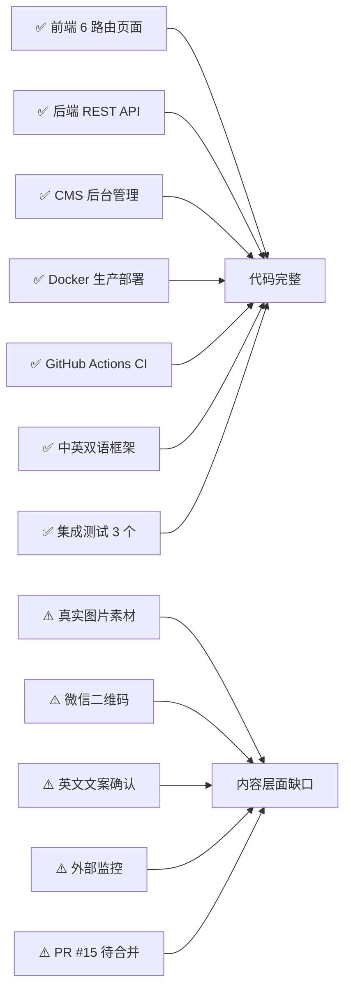
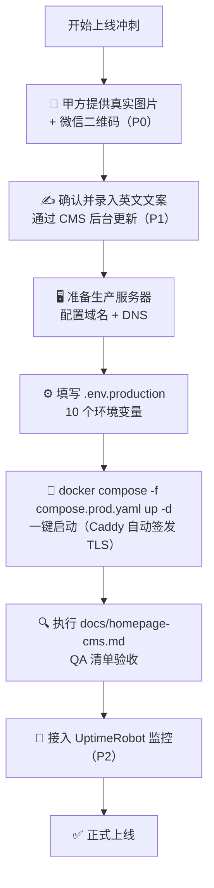

# 观止东方官网 — 上线差距分析报告

> 仓库：[cvcingcvc-code/guanzhi-oriental-website](https://github.com/cvcingcvc-code/guanzhi-oriental-website)  
> 分析时间：2026-11-18  
> 总体状态：**工程完整，内容/素材层面有缺口，可进入上线冲刺阶段**

---

## 一、项目全貌

| 字段 | 详情 |
|------|------|
| 类型 | 全栈品牌官网（前端 SPA + REST API + CMS 后台 + PostgreSQL） |
| 品牌定位 | 东方文化深度体验产品研发与供应机构（B2B） |
| 主语言 | TypeScript（91%）|
| 最后提交 | `eaed63a`，2026-10-22（fix: Caddyfile 静态根路径指令）|
| 测试总数 | **74 个**（前端 26 + 后端 45 + 顶层集成测试 3） |
| Open PR | 2 个（详见下文） |
| 语言分布 | TypeScript 91% / CSS 3.7% / JavaScript 3.7% / 其他 |

### 技术栈快览

```
前端：React 18 + Vite 6 + Tailwind CSS + GSAP ScrollTrigger
后端：Fastify 5 + Drizzle ORM + PostgreSQL 17 + Zod
部署：Docker Compose + Caddy（自动 TLS）+ GitHub Actions CI
顶层集成测试：tests/api.test.js + tests/html.test.js + tests/validate.test.js
```

> [!NOTE]
> 仓库根目录存在 `.openai/hosting.json`，表明项目可能有 OpenAI/AI 相关托管或集成配置，具体用途待确认。

---

## 二、距离正式上架还缺什么

> [!IMPORTANT]
> **浏览器直接验证**：仓库当前有 **2 个 Open PR**，0 个 Open Issue。PR #15（2026-11-06）标题为「V2.1 真实验收 — 六页/CMS/询盘/生产路由通过，修复 2 个 P1」，说明团队近期完成了一轮正式验收测试，整体已接近上线状态。

### 🔴 P0 — 必须完成才能上线

| # | 缺口 | 说明 | 责任方 |
|---|------|------|--------|
| 1 | **真实产品摄影图片** | 多个页面区块仍使用占位图（`public/images/` 中尚有 placeholder），用户访问时看到的是示意性内容而非真实品牌形象 | 甲方提供素材 → 开发优化为 WebP 并替换 |
| 2 | **微信二维码** | Contact 页的微信联系入口仍为占位图，直接影响 B 端客户的第一联系路径 | 甲方提供二维码图片 → 开发集成 |
| 3 | **合并并关闭 PR #15** | V2.1 验收 PR 已通过测试但仍处于 Open 状态，需评审合并后才能进行最终上线 | 开发主导 |

### 🟡 P1 — 上线前强烈建议完成

| # | 缺口 | 说明 | 责任方 |
|---|------|------|--------|
| 4 | **英文文案最终确认** | About 区块以外的 6 个首页区块（hero / capabilities / motifs / jiangnan / partners / contact）的英文草稿尚待甲方审阅确认 | 甲方审稿 → 通过 CMS 后台更新，无需改代码 |
| 5 | **生产服务器准备** | 需要一台已配置域名 DNS 指向的服务器，克隆仓库、填写 `.env.production` 中的 10 个环境变量后即可一键 `docker compose up` | 运维/甲方 |
| 6 | **域名与 DNS** | Caddy 自动申请 TLS，但前提是域名已正确解析到服务器 IP | 甲方 |
| 7 | **修改默认管理员密码** | README 明确标注「首次上线后必做」，种子管理员密码需立即通过 API 或数据库修改 | 开发/运维 |

### 🟢 P2 — 上线后跟进

| # | 缺口 | 说明 |
|---|------|------|
| 8 | **外部可用性监控** | 接入 UptimeRobot / BetterStack 等，当服务宕机时自动告警 |
| 9 | **询盘邮件通知** | 可选：配置 `RESEND_API_KEY` 以在新询盘提交时收到邮件（代码已实现，配置才启用） |
| 10 | **数据库定期备份验证** | `deploy/backup-db.sh` 已写好，需设置定时任务（cron）并验证一次恢复流程 |
| 11 | **PR #2（CI 配置）处理** | 仓库首个 CI PR 自 2026-08-12 起一直未合并（可能是有意保留历史），建议评估是否关闭或合并 |

---

## 三、现有代码层面的缺点

> [!NOTE]
> 以下缺点是基于仓库公开代码和结构推断的，部分可能是有意为之的设计取舍。

### 3.1 架构与扩展性

| 缺点 | 影响 | 建议 |
|------|------|------|
| **单体 Docker Compose，无水平扩展能力** | 流量突增时只能垂直扩容（换更大服务器）；API 服务单点故障 | 对于品牌官网当前阶段影响不大，若未来 B2B 流量上涨可引入 Nginx/Traefik 负载均衡 |
| **CMS 功能偏窄** | 仅首页 7 个区块可管理，`/about`/`/capabilities`/`/jiangnan`/`/partners` 等独立页面内容**硬编码在前端**，无法通过 CMS 后台修改 | 若需频繁改其他页面内容，每次都要改代码重新部署 |
| **媒体库功能基础** | 无图片裁剪、批量上传、CDN 分发、文件夹组织等功能 | 对于当前小规模网站够用；内容增多后建议集成 Cloudinary 或类似服务 |

### 3.2 前端体验

| 缺点 | 影响 | 建议 |
|------|------|------|
| **Hero 视频（hero-loop.mp4）无自适应码率** | 移动端用户可能加载大体积视频，影响首屏性能 | 生成多码率版本（`<source>` 多 `type`），或使用 `preload="none"` + 懒加载 |
| **语言切换为 URL 参数（`?locale=zh-CN`）** | 分享链接需手动带参数；搜索引擎可能将中英文视为同一 URL 的参数变体 | 若 SEO 重要，建议改为路径前缀方案（`/en/`），并配置 `hreflang` |
| **SPA 路由，无 SSR/SSG** | 搜索引擎爬取 JS 渲染页面能力参差不齐，可能影响自然搜索收录 | 若 SEO 是核心需求，可迁移至 Next.js 或 Astro；目前有 `sitemap.xml` 和 OG 标签，对品牌官网基本够用 |
| **GSAP ScrollTrigger 动效未提及减弱动效（prefers-reduced-motion）** | 对光敏感用户或偏好无动效的用户体验不友好，也是无障碍合规项 | 加入 `@media (prefers-reduced-motion: reduce)` 时关闭或减弱动效 |

### 3.3 安全与合规

| 缺点 | 影响 | 建议 |
|------|------|------|
| **仅一个管理员账号（无多用户/角色系统）** | 团队多人操作时共用同一组账密，无法追踪具体操作者；无法授权只读审核角色 | 当前品牌官网场景可接受；若未来有多编辑需求需扩展 |
| **JWT 无刷新令牌机制，默认 8 小时过期** | 后台编辑者长时间操作后 token 过期需重新登录，体验欠佳 | 实现 refresh token 或无感续签 |
| **询盘表单缺少前端限速/验证码** | 恶意机器人可绕过 API 限速直接刷提交（后端有 `@fastify/rate-limit`，但无额外人机校验） | 添加 Turnstile / hCaptcha 或简单 honeypot 字段 |

### 3.4 运维与可观测性

| 缺点 | 影响 | 建议 |
|------|------|------|
| **无结构化日志聚合** | Caddy 日志仅本地轮转（10MB×5份），无远程汇聚，出问题难以回溯 | 对接 Loki / Datadog / Sentry 等 |
| **无应用层性能监控（APM）** | 无法感知 API 响应时间劣化、慢查询等问题 | 接入 OpenTelemetry 或类似 APM |
| **数据库无读写分离/连接池上限配置** | 高并发下 Drizzle 连接池可能耗尽 | 检查并显式设置 `max` 连接数，或引入 PgBouncer |

### 3.5 内容与文案

| 缺点 | 影响 | 建议 |
|------|------|------|
| **英文文案为草稿状态** | 若有海外 B 端客户，英文页面质量直接影响品牌专业度 | P1 优先级，甲方确认后通过 CMS 更新 |
| **`sitemap.xml` 为静态文件** | 若 CMS 新增页面，sitemap 不会自动更新 | 改为后端动态生成，或在 CD 管道中重新生成 |

---

## 四、功能完成度总览



| 层面 | 完成度 | 备注 |
|------|--------|------|
| 工程代码 | ██████████ 95% | 核心功能全部完成 |
| CI/CD 流水线 | ██████████ 100% | 5 Job，含生产栈冒烟 |
| 安全加固 | ████████░░ 80% | 询盘无前端人机校验 |
| 测试覆盖 | ████████░░ 82% | 74 个测试（含顶层集成） |
| 真实内容素材 | ████░░░░░░ 40% | 图片/微信二维码缺失 |
| 运维可观测性 | ████░░░░░░ 40% | 无远程日志聚合/APM |

---

## 五、上线冲刺建议路径



---

## 六、亮点值得肯定

> [!TIP]
> 这个项目的工程质量**明显高于同体量的品牌官网项目**，以下几点尤其值得肯定：

- 🔒 **安全设计细致**：JWT 弱密钥启动拒绝、SVG 上传完全禁止、魔数检测、IP 加盐哈希、CSP/HSTS 全套
- 🧪 **测试覆盖充分**：71 个测试，含安全场景（路径穿越、文件类型伪造）
- 🚀 **CI 质量门禁严格**：5 个 Job，含生产栈 Docker 冒烟测试和依赖漏洞扫描
- 📄 **文档体系完整**：DEPLOY.md、API.md、CMS 使用指南、开发者入职文档一应俱全
- 🛡️ **API 故障降级**：后端挂掉时前端自动回退中文兜底内容，不黑屏
- 🎨 **设计系统 Token**：宣纸/墨色/朱砂/青瓷，东方气质一致性有保障
